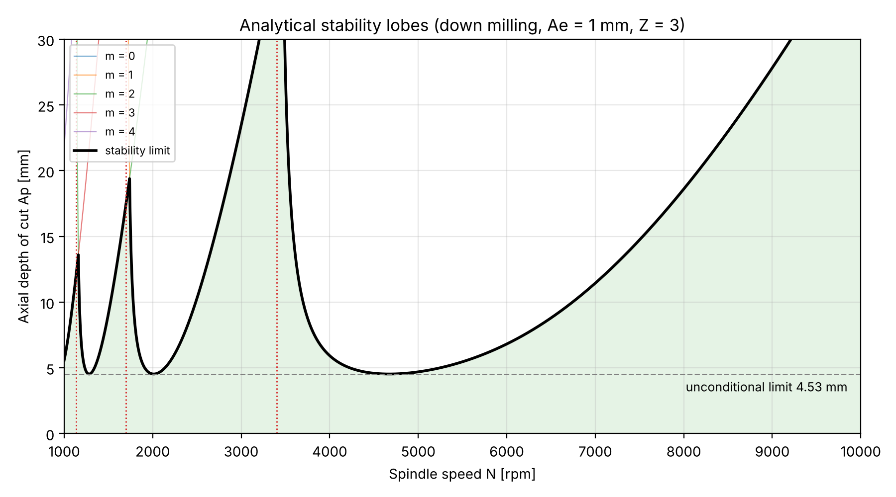
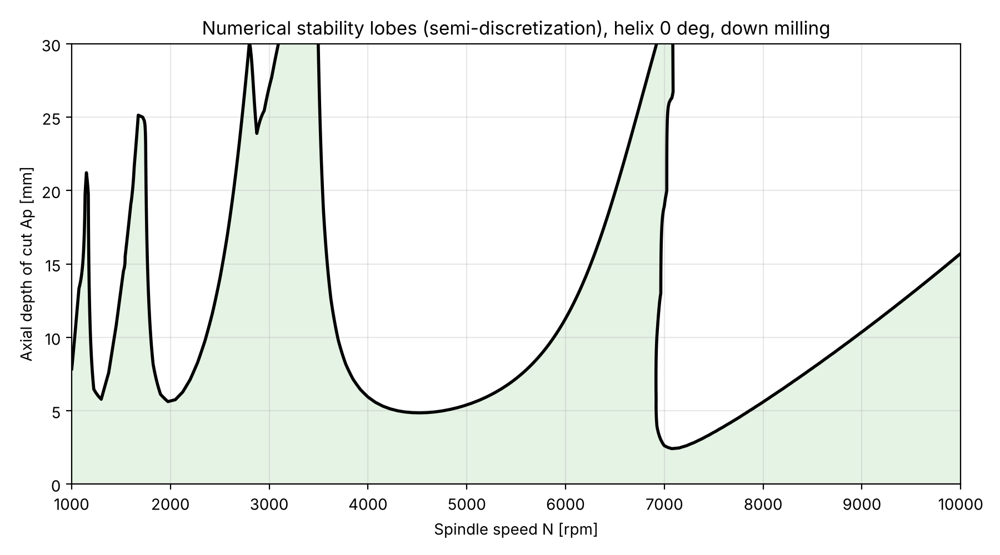
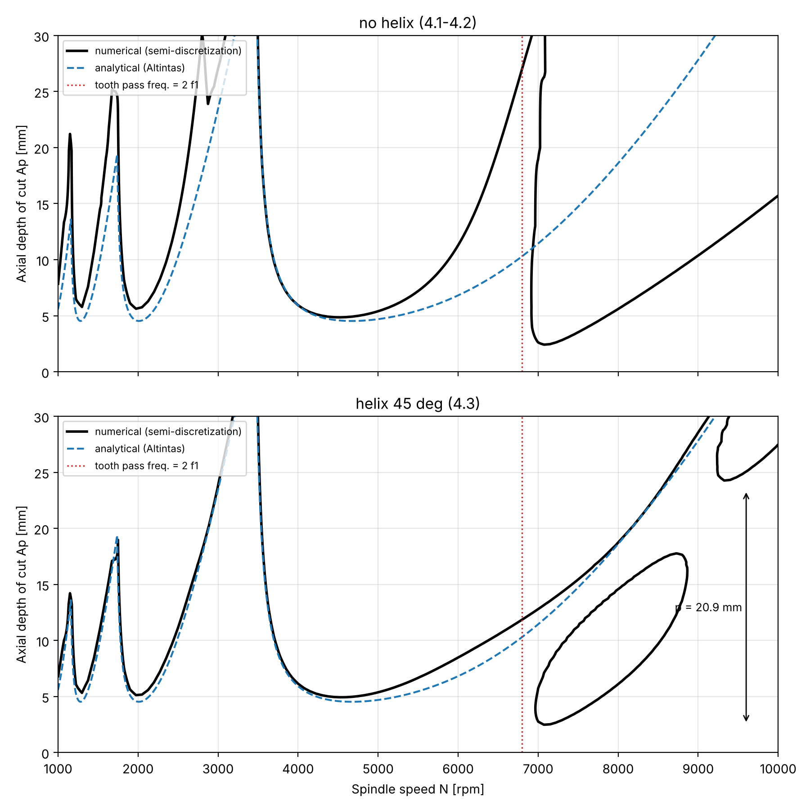
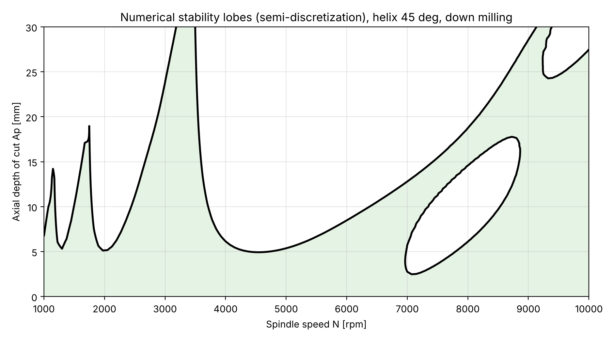

# Tutorial – Stability lobes: draft answers

Data: f1 = ω1/2π = **170.0 Hz**, k = m1·ω1² = **3.00·10⁶ N/m**, kr = Kr/Kt = **0.273**, Ae/D = 0.05.
Down milling (slide 20): φst = π − arccos((R−Ae)/R) = **154.2°**, φex = **180°** → each tooth cuts over 25.8° only.

## 3.1 Assumptions of the analytical model (Altintas & Budak 1995)
- Single degree of freedom: only the wall is flexible (direction normal to the wall), the tool is rigid.
- Linear cutting law: F = Kt·h·Ap, radial force Kr = kr·Kt.
- Regenerative chip thickness with a constant delay τ = 60/(N·Z) (equally spaced teeth, no runout).
- No helix angle ⇒ orthogonal cut.
- The time-varying directional coefficient is replaced by its **average** over one revolution (constant force, coefficient αx) ⇒ the problem becomes time-invariant.
- Stability limit = root of the characteristic equation on the imaginary axis (s = jωc).

## 3.2 Preferred spindle speeds (without drawing the lobes)
Tooth pass frequency equal to the natural frequency or a sub-multiple: Z·N/60 = f1/(m+1)

$$N_m = \frac{60 f_1}{Z(m+1)} \;\Rightarrow\; N_0 = 3400,\; N_1 = 1700,\; N_2 = 1133,\; N_3 = 850 \text{ rpm}$$

## 3.3 Analytical lobes (Excel)

- αx = −0.420
- **Unconditional limit of stability: Ap,lim = 4.53 mm** (at fc ≈ 176.7 Hz, i.e. ≈ f1(1+ξ))
- Lobe peaks (damping shifts them slightly to the right of N_m): **3469 rpm** (> 30 mm), 1739 rpm (19.4 mm), 1161 rpm (13.6 mm)
- Optimal spindle speed ranges, e.g. stable for Ap = 9 mm (2 × unconditional limit):
  1081–1176 rpm, 1499–1790 rpm, **2440–3737 rpm** (main lobe), > 6556 rpm

## 4.1 Numerical lobes without helix

## 4.2 Comparison with the analytical lobes

- **Hopf lobes**: same positions; numerical minimum 4.85 mm (at ≈ 4525 rpm) vs 4.53 mm analytical ⇒ the analytical model is slightly conservative; at low speed the numerical peaks are higher.
- **New instability**: a **flip lobe** (period doubling) appears for N ≳ 6900 rpm, with minimum **Ap ≈ 2.4 mm at ≈ 7075 rpm**, i.e. **below the analytical unconditional limit**. The analytical model predicts a stable cut there up to ≈ 10 mm.
- Speed for a ratio 2 between tooth pass frequency and natural frequency:

$$\frac{Z N}{60} = 2 f_1 \;\Rightarrow\; N = \frac{2 \cdot 170.0 \cdot 60}{3} = 6800 \text{ rpm}$$

  → exactly where the flip lobe starts.
- Impact of interrupted milling: with Ae/D = 0.05 each tooth cuts only 25.8° per revolution (Z·25.8°/360° ≈ 21 % of the time, never two teeth at once) ⇒ the cutting force is a train of pulses, far from the constant average force of the analytical model ⇒ period-doubling instability that the analytical approach cannot predict.

## 4.3 With the helix angle η = 45°

- Hopf lobes almost unchanged (minimum 4.93 mm) and closer to the analytical curve: the helix spreads the engagement along z ⇒ more constant force.
- The flip lobe is no longer open: it becomes a **closed island** (≈ 2.5–18 mm, ≈ 6950–8850 rpm), and a second island starts at ≈ 24.5 mm.
- Axial pitch of the tool:

$$p = \frac{\pi D}{Z \tan\eta} = \frac{\pi \cdot 20}{3 \cdot \tan 45°} = 20.9 \text{ mm}$$

  The islands repeat with a period ≈ p in depth: when Ap is a multiple of p, the engaged cutting-edge length is constant during the rotation ⇒ the directional coefficient H(t) is constant ⇒ no period doubling. In between, H(t) varies and the flip instability comes back.

## 4.4 Conclusion
- Numerical lobes model what the analytical ones neglect: interrupted cutting (flip lobes), helix angle (islands), and could include runout, variable pitch…
- For this finishing operation (low Ae/D, few teeth) the analytical model is **unsafe** around a tooth pass frequency ≈ 2 f1 (6800–8800 rpm), even though it is good for the Hopf lobes.
- Production: the analytical approach is fast and sufficient for roughing with multi-teeth tools and for a first choice of the spindle speed; for finishing with low radial immersion, the numerical approach (≈ 10 s of computation here) should be used. In both cases the result is only as good as the identified dynamic parameters (f1, k, ξ) and cutting coefficients.
